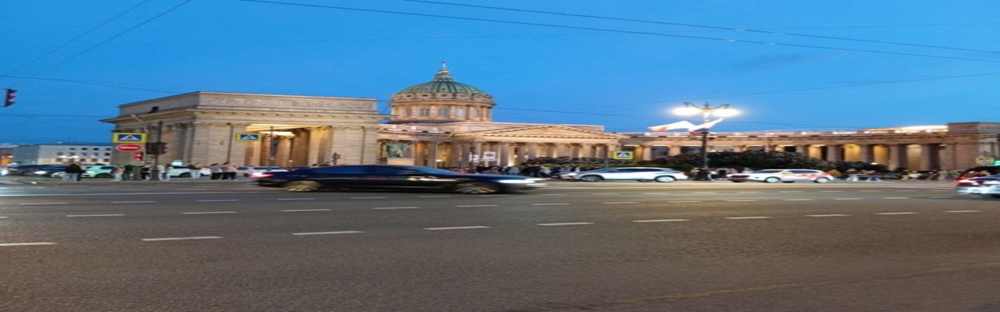

  

 

<h2>Обo мне</h2>

Живу в России, Изучаю C++ и Python. Делаю Telegram-ботов и веб-сервисы, разворачиваю проекты на Linux и настраиваю сеть.

В программировании пока набираюсь опыта. Учусь сам и пользуюсь нейросетями, чтобы разбирать незнакомый код и искать причины ошибок. То, что узнаю, пробую на своих проектах.

 

<h2>Flessowy</h2>

> Мой проект. На сайте можно купить подписку.

[Сайт проекта](https://jarvispro.shop) • [Бот](https://t.me/jarvis_free) • [Кабинет](https://jarvispro.shop/cabinet)

 

<h2>Стек</h2>

  
  
  

 

  

